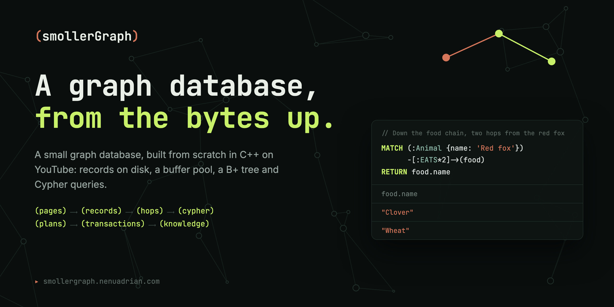

[](https://smollergraph.nenuadrian.com)

# smollerGraph

[](https://github.com/nenuadrian/smollergraph/actions/workflows/ci.yml)

A small graph database, built from scratch in C++ on the YouTube series
[Building smollerGraph](https://smollergraph.nenuadrian.com). Each step of each episode is a tag
in this repository, so you can check out the code at any point in a video.

It keeps a graph in a folder of fixed-size records, in pages of 4 KiB that a buffer pool keeps in
memory, with a B+ tree that finds a node by its name, and each node's and relationship's properties
in a chain of records of their own. Labels and relationship types are tokens, numbers kept in place
of their names, as in Neo4j, and each relationship is in two chains, one of the relationships that
start at a node and one of those that end at it, so they can be followed either way. It loads facts
written as Cypher patterns, one a line, with a label after a colon and properties in braces, such as
`(Rabbit:Animal {legs: 4})`, walks relationships of one type from a node, and draws the graph in a
browser.

## Building and running

You need CMake 3.28 or newer, Ninja and a C++20 compiler.

```bash
cmake -S . -B build -G Ninja
cmake --build build
./build/sg load animals.sg data/animals.txt
./build/sg walk animals.sg "Red fox" EATS 2
./build/sg path animals.sg "Tawny owl" Rabbit EATS
./build/sg path friends.sg "Person 1" "Person 2" KNOWS weight
./build/sg query animals.sg "MATCH (a {name: 'Red fox'})-[:EATS*2]->(c) RETURN c.name"
```

`sg path` finds a shortest path between two nodes, along relationships of one type followed either
way, with a breadth-first search from both ends, which meet in the middle, and says how many nodes
it reached and how many pages it read. Given a property's key, such as `weight`, it finds a cheapest
path instead, whose weights add up to the least, with Dijkstra's algorithm, from both ends too.

`sg embed` gives each node an embedding, a vector of 256 numbers that stands for where it is in the
graph, with FastRP, as Neo4j's Graph Data Science library computes them: a sparse random vector for
each node, then rounds in which a node's vector becomes the sum of its neighbours' vectors. It keeps
them in the graph's folder, a kibibyte for each node, and `sg similar` prints the nodes whose
embeddings point most nearly the same way as a node's, by their cosine:

```bash
./build/sg embed wikidata.sg PARENT_TAXON
./build/sg similar wikidata.sg "Blue whale" 10
```

`sg query` answers a small subset of [Cypher](https://opencypher.org): a pattern of nodes, with a
label and properties to match, joined by relationships of one type that go right, `-[:EATS]->`,
left, `<-[:EATS]-`, or either way, `-[:EATS]-`, for one hop or `*N`, then an optional `WHERE` of
comparisons joined by `AND`, such as `b.weight_g < 1000`, and `RETURN [DISTINCT]` properties of its
variables. `MATCH p = shortestPath((a {name: 'Red fox'})-[:PARENT_TAXON*]-(b {name: 'Lion'}))`
finds a shortest path between two nodes, which `RETURN p` returns, and `length(p)` its length.
`MATCH p = (a {name: 'Person 1'})-[:KNOWS* WSHORTEST(weight)]-(b {name: 'Person 2'})`, as Kùzu
writes it, finds a cheapest path, and `cost(p)` returns what its weights add up to. The plan starts from the node that's cheapest to
find, by its name in the index, then by its label, and expands from it both ways along the pattern,
or for a shortest path, finds both its ends, and `EXPLAIN` in front shows it.

## Mammals and birds from Wikidata

`data/wikidata.txt` holds 21,834 taxa from [Wikidata](https://www.wikidata.org), which is under
CC0: each species of mammal and bird that the IUCN has assessed, with its scientific name, its
conservation status, its weight when Wikidata has one, and the genera, families, orders and classes
above it, joined by `PARENT_TAXON`. `tools/wikidata.py` writes it from Wikidata's query service, in
a few minutes:

```bash
python3 tools/wikidata.py data/wikidata.txt
./build/sg load wikidata.sg data/wikidata.txt
./build/sg query wikidata.sg "MATCH (s:Species {name: 'Red fox'})-[:PARENT_TAXON*3]->(o) RETURN o.name"
```

## The UI

`sg serve` serves a graph over HTTP, with a page that runs Cypher queries and draws what they
return on a canvas, a path as its nodes and the relationships between them, laid out by [D3](https://d3js.org)'s force simulation, up to 500 nodes at a
time, with the rows in a table, the plan, and what the query cost on the server. A search finds a
node by its name, clicking a node shows its record as it's kept on disk, with its chain of
properties and its chains of relationships out and in, and double-clicking it draws the nodes at
the other end of both. Its second button draws the ten nodes whose embeddings are most like its, each
at a distance that grows as their cosine falls:

```bash
./build/sg serve wikidata.sg 8474
```

Then open http://localhost:8474. Or, with Docker, `docker compose up` loads the mammals and birds,
gives them their embeddings and serves them there, and `docker compose -f compose.yaml -f compose.friends.yaml up` serves the
friends from the benchmarks, with their weights, which the page draws on each relationship.

## Deploying

`deploy.sh` copies the committed code to a server over SSH, and builds and runs it there with
Docker Compose. Caddy, in a container of its own, serves the page's files on port 8474 and passes
`/api/` requests on to `sg serve`, which isn't published:

```bash
./deploy.sh debian@203.0.113.7
```

The server needs Docker, with Compose. The UI answers anyone who can reach the port, and it reads
the graph, so there's nothing to change through it.

## Testing

```bash
ctest --test-dir build --output-on-failure
```

## Benchmarks

`make_friends` writes a social graph of made-up people, who each know ten others, with a weight on
each friendship in the facts, as LDBC's Social Network Benchmark weighs them in its cheapest path
question: `max(round(40 - sqrt(messages)), 1)`, for a number of messages the two have sent each
other, from 1 to 1,600.

`bench/compare.py` loads a generated social graph into smollerGraph, Kùzu and Neo4j (in Docker),
and asks each of them two questions in Cypher from a thousand people, three times over: how many
people are two hops of KNOWS away, following them out of a person, and following them in. `sg bench`
parses and plans each query as well as running it. It writes the medians to `bench/results.json`:

```bash
./build/make_friends 100000 10 bench/data
uv run --with kuzu --with neo4j python bench/compare.py
```

`bench/ui.py` measures how many frames a second Chromium paints while the page's layout moves a
made-up graph, from 500 nodes to 20,000, drawn with SVG, drawn on a canvas, and not drawn at all,
with `sg serve` serving `ui/bench.html`, and writes them to `bench/ui.json`. It opens a window, as
Chromium paints a canvas in software without one:

```bash
./build/sg serve animals.sg 8474 &
uv run --with playwright==1.64.0 python bench/ui.py
```

## With Docker

The same build and tests on a clean Ubuntu, as CI runs them on each push:

```bash
docker build --target test .
```

## Licence

MIT, see [LICENSE](LICENSE).
